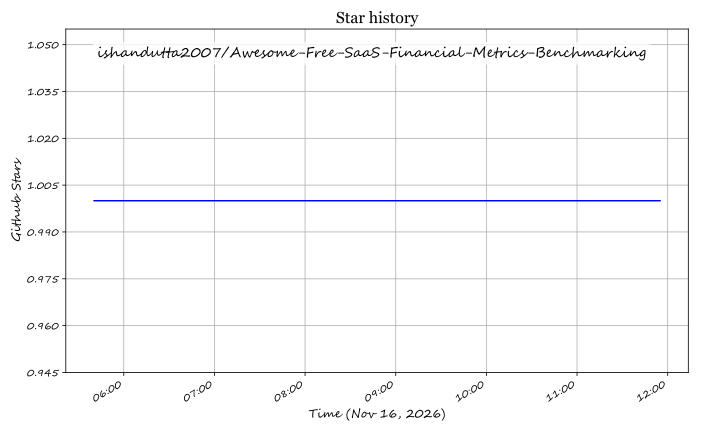

  

# 📈 Awesome Free SaaS Financial Metrics &amp; Benchmarking

**The Definitive Curated Directory of Free SaaS Analytics Platforms &amp; Self-Hosted Open-Source Metrics Engines**  
*Track MRR, ARR, Churn, LTV, Quick Ratio, Cohort Retention, and Financial Benchmarks without Per-Subscriber Fees*  

---

## 🧭 Executive Summary &amp; Overview

Welcome to **Awesome Free SaaS Financial Metrics &amp; Benchmarking**! Tracking core subscription metrics like **MRR (Monthly Recurring Revenue)**, **Net Churn**, **Customer Lifetime Value (LTV)**, and **Customer Acquisition Cost (CAC)** is fundamental for any bootstrapped founder, finance team, or SaaS CFO. However, commercial analytics solutions frequently charge steep, escalating fees pegged directly to your revenue or customer count.

This repository tracks high-impact **hosted SaaS platforms offering permanent free tiers** alongside **self-hosted, open-source projects** that calculate subscription intelligence locally—empowering you with full data ownership, privacy, and zero licensing overhead.

---

## 📑 Table of Contents
- [📊 Sector Overview &amp; Market Dynamics](#-sector-overview--market-dynamics)
- [☁️ SaaS / Hosted Platforms](#️-saas--hosted-platforms)
- [💻 Open-Source GitHub Projects](#-open-source-github-projects)
- [🛠️ Key SaaS Metrics Formula Cheat-Sheet](#️-key-saas-metrics-formula-cheat-sheet)
- [🤝 How to Contribute](#-how-to-contribute)
- [💖 Support &amp; Sponsorship](#-support--sponsorship)
- [⭐ Star History](#-star-history)
- [⚖️ Disclaimer](#️-disclaimer)

---

## 📊 Sector Overview &amp; Market Dynamics

The global subscription analytics and billing management market is valued at approximately **$8–9 billion** (projected to exceed **$18 billion by 2030** at ~15% CAGR). 

The industry displays **moderate fragmentation with aggressive consolidation pressure at the payment gateway layer**:
- **Core Payment Infrastructure (Consolidated)**: Mega-scale merchant-of-record and payment processors (e.g., Stripe, Paddle) dominate baseline transaction processing and frequently absorb analytics modules (e.g., ProfitWell, Stripe Sigma) as retention utilities to anchor customer volume.
- **Independent Specialized Analytics (Fragmented Long-Tail)**: Independent tools compete through deep multi-gateway reconciliation (Stripe + PayPal + Lemon Squeezy), granular cohort retention intelligence, customizable dunning automation, and developer-friendly data pipelines.
- **The Open-Source Wave**: Rapidly emerging to decouple sensitive customer transaction records from third-party vendor clouds, offering self-hosted dashboards and scriptable revenue intelligence directly on local databases.

---

## ☁️ SaaS / Hosted Platforms

*Below is a curated comparison of notable hosted subscription intelligence platforms with viable free tiers or evaluations, ordered by company size &amp; scale (descending):*

| Product | Company Size (Valuation / Revenue) | Starting Paid Pricing | Free Tier / Trial Limits | Core Capabilities &amp; Highlights |
|---|---|---|---|---|
| **[Stripe Sigma](https://stripe.com/sigma)** | 🏛️ **~$159B valuation** (~$6.8B net revenue) | **$10–$15/month** (tiered by successful monthly transaction volume) | **30-day free trial** with full SQL access &amp; unmetered queries; **free forever** in Stripe Test Mode / sandboxes with zero query or usage limits | 🔍 Direct SQL access to structured Stripe transaction data. Query custom MRR, refunds, and cohort cohorts without maintaining separate ETL pipelines. |
| **[ProfitWell Metrics (Paddle)](https://www.profitwell.com/)** | 🦄 **$1.4B parent valuation** (acquired for >$200M) | **Free** (core metrics); monetization via Retain &amp; Price Intelligently add-ons | **Free forever** with unlimited team members, unlimited paying customers, and unlimited historical data for core MRR, churn, LTV, cohort retention, and benchmarking | 🏆 **The free gold standard for SaaS subscription analytics.** Aggregates and benchmarks financial KPIs across 30,000+ subscription companies worldwide. |
| **[Databox SaaS Metrics](https://databox.com/)** | 📈 **~$8.4M–$20.5M ARR** (~$4.8M funding raised) | **$71/month** (Analyst plan billed annually; $79/mo billed monthly) | **Free forever plan**: limited to 1 user, 3 data source connections, 1 dashboard, 10 custom metrics, and daily data sync (plus 14-day free trial of paid plans) | 📊 Executive KPI dashboards with pre-built SaaS templates. Integrates Stripe, ChartMogul, Google Analytics, and 100+ connectors for real-time visibility. |
| **[ChartMogul](https://chartmogul.com/)** | 🚀 **~$7.2M ARR** (~$3.7M funding raised) | **$57/month** ($69/mo billed monthly for Starter tier for up to 3 users) | **Free forever plan**: valid up to **$10K MRR ($120K ARR)** with unlimited users and 1 primary billing source; paid plans offer a **14-day free trial** | 💎 Specialized revenue reporting, subscription lifecycle analytics, cohort heatmaps, MRR movement waterfalls, and CRM sync. |
| **[Geckoboard](https://www.geckoboard.com/)** | 🖥️ **~$3.5M–$7.2M ARR** (~$4.1M funding raised) | **$60/month** ($79/mo billed monthly for Essentials tier) | **14-day free trial** with full access to all features, integrations, and dashboards (no credit card required; no permanent free tier) | 📺 TV dashboard display software optimized for wall displays, team syncs, and real-time Stripe/Chargebee transaction metrics monitoring. |
| **[Baremetrics](https://baremetrics.com/)** | 💼 **$4M acquisition price** (~$1.5M ARR at acquisition) | **$49/month** (Launch tier for businesses up to $360K ARR; billed annually) | **14-day free trial** with full access to all metrics and dashboard features (no permanent free tier) | ⚡ The original Stripe metrics pioneer: provides MRR expansion/contraction analytics, churn benchmarks, cancellation surveys, and dunning tools. |

---

## 💻 Open-Source GitHub Projects

*Self-hosted subscription intelligence, MRR calculators, and BI platforms for teams seeking 100% data sovereignity, privacy, and zero per-subscriber fees. **Sorted strictly by GitHub Stars_Count (Descending):***

| Project | GitHub_Stars | Architecture &amp; Focus | Description &amp; Core Strengths |
|---|---|---|---|
| **[Apache Superset](https://github.com/apache/superset)** |  | Python / TypeScript (Enterprise BI) | 🌐 **Enterprise-grade open-source data exploration and BI platform.** Directly queries SQL billing warehouses (ClickHouse, Snowflake, PostgreSQL) to build tailored MRR movement waterfalls, cohort heatmaps, and executive SaaS metric dashboards. |
| **[Metabase](https://github.com/metabase/metabase)** |  | Clojure / JavaScript (Self-Hosted BI) | 🔍 **The friendliest open-source BI tool.** Connect directly to your Stripe replica or Postgres billing database to build MRR, churn, and LTV charts with no SQL required using the visual Question Builder. |
| **[Chartbrew](https://github.com/chartbrew/chartbrew)** |  | Node.js / React (Live Dashboarding) | 📊 **Open-source live dashboard platform with native Stripe integration.** Connects to APIs, PostgreSQL, and MySQL to craft embeddable real-time SaaS dashboards tracking MRR, ARR, active subscriptions, and payment status. |
| **[Pulse](https://github.com/mike-paper/pulse)** |  | TypeScript / Next.js (SaaS Analytics) | 💓 **Open-source SaaS metrics engine built by Paper.** Focuses on subscription analytics, clean cohort retention visualization, and revenue tracking without monthly subscription fees. |
| **[Profitable](https://github.com/rameerez/profitable)** |  | Ruby on Rails (Embedded Gem) | 💸 **Self-hosted MRR dashboard gem for Pay-powered Rails SaaS apps.** Computes MRR, ARR, TTM, churn, LTV, ARPU, total revenue, and valuation multiples straight from your production database. |
| **[Revenut](https://github.com/hbcondo/revenut-app)** |  | FastAPI / React Native PWA | 🛡️ **Fraud-aware open-source Stripe revenue forecasting.** Specifically designed to exclude fraudulent and refunded card transactions that distort standard MRR charts. Calculates realized revenue and unrealized pipeline. |
| **[SimpleStats](https://github.com/simplestats-io/app)** |  | PHP / Laravel (Full Funnel) | 🎯 **Full-funnel privacy-friendly analytics from pageview to Stripe payment.** Tracks MRR/ARR, churn, and retention alongside CAC and ROAS by attributing revenue to UTM acquisition campaigns. |
| **[IncomeOS](https://github.com/Perufitlife/incomeos)** |  | Next.js / TypeScript (Revenue Aggregator) | 🤖 **Open-source, self-hosted passive income dashboard.** Aggregates Stripe, affiliate platforms, and billing streams into one screen. Includes an **MCP (Model Context Protocol)** server so AI assistants can directly query revenue stats. |
| **[ChurnLens](https://github.com/cognis-digital/churnlens)** |  | Rust / CLI &amp; MCP (Single-Purpose) | ⚡ **Scriptable open-source SaaS metrics calculator.** Computes MRR, churn, and LTV directly from Stripe APIs or CSV files. Features CLI JSON output for CI/CD gates and native MCP support for AI agent workflows *(Note: COCL v1.0 license)*. |
| **[OpenProfit](https://alternativeto.net/software/openprofit/about/)** | — | Docker / Python (Margin Engine) | 🧠 **Profit-per-product subscription intelligence.** Reads Stripe alongside OpenAI, Anthropic, and cloud infrastructure billing APIs to compute true net margins and profit after AI model/hosting token costs *(MIT licensed)*. |

---

## 🛠️ Key SaaS Metrics Formula Cheat-Sheet

| Metric | Calculation Formula | Benchmark Target (B2B SaaS) |
|---|---|---|
| **MRR (Monthly Recurring Revenue)** | `∑ (Active Paying Customers × Monthly Plan Price)` | Steady month-over-month growth (>15% early stage) |
| **ARR (Annual Recurring Revenue)** | `MRR × 12` | Predictable annual run-rate indicator |
| **Net Revenue Retention (NRR)** | `[(Starting MRR + Expansion - Contraction - Churn) / Starting MRR] × 100` | **>105%** for SMB SaaS; **>120%** for Enterprise |
| **Gross Monthly Churn** | `(Lost MRR in Month / MRR at Start of Month) × 100` | **<1%** for Enterprise; **<3–5%** for SMB |
| **LTV (Customer Lifetime Value)** | `ARPU (Average Revenue Per User) / Gross Churn Rate` | High multiple of CAC |
| **LTV to CAC Ratio** | `LTV / CAC (Customer Acquisition Cost)` | **≥ 3:1** (healthy sustainable unit economics) |
| **SaaS Quick Ratio** | `(New MRR + Expansion MRR) / (Churned MRR + Contraction MRR)` | **> 4.0** (rapid, efficient expansion) |

---

## 🤝 How to Contribute

Contributions, project suggestions, and documentation improvements are warmly welcomed!

1. 🍴 **Fork the Repository** on GitHub.
2. 🌿 **Create a Feature Branch** (`git checkout -b feature/awesome-saas-tool`).
3. 📝 **Add or Update the Tool** in `README.md` (keep descriptions factual, include exact pricing/limits or Stars_Badges, and maintain descending sort order).
4. ✅ **Ensure Proper Formatting &amp; Links**.
5. 🚀 **Submit a Pull Request** with a brief summary of why the addition is valuable to the SaaS community.

---

## 💖 Support &amp; Sponsorship

Thank you so much for exploring and using **Awesome Free SaaS Financial Metrics &amp; Benchmarking**! 🙏

Maintaining and curating open, accurate, and free developer resources takes time and continuous research. If this curated list has saved you time, reduced your software tooling bills, or helped your startup scale smarter, please consider supporting the project:

- ⭐ **Star this repository** to help others discover it on GitHub.
- 🍴 **Fork and share** with founders, indie hackers, and finance engineering teams.
- ☕ **Buy a coffee or sponsor ongoing maintenance**: Support directly via the [GitHub Sponsors Dashboard](https://github.com/sponsors/ishandutta2007).

Your generosity keeps this ecosystem directory free, updated, and community-first!

---

## ⭐ Star History

---

## ⚖️ Disclaimer

- This repository is a **community-curated informational directory** provided "as is" — inclusion does not constitute a formal commercial endorsement or financial advice.
- SaaS metrics and financial calculation tools interact directly with sensitive customer subscription records, billing logs, and payment tokens. Always implement least-privilege API access keys, test mode sandboxes, and verify compliance with regional financial data protection regulations (e.g., GDPR, SOC 2, PCI-DSS).
- Open-source tools vary in maturity and licensing: confirm whether source-available terms apply before commercial deployment.

---

  <b>Built for bootstrapped founders, indie hackers, CFOs, and finance engineering teams worldwide. 🚀</b>

## ⭐ Star History

<a href="https://star-history.com/#ishandutta2007/Awesome-Free-SaaS-Financial-Metrics-Benchmarking&Timeline" align="center">
  <picture>
    <source media="(prefers-color-scheme: dark)" srcset="assets/ishandutta2007_Awesome-Free-SaaS-Financial-Metrics-Benchmarking_growth.svg">
    
  </picture>
</a>
